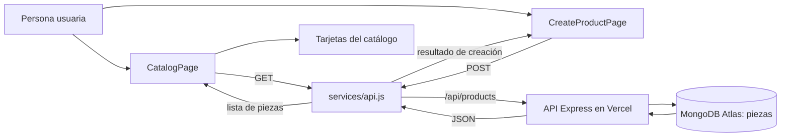

# Nana Nocturna — frontend PEC 4

Interfaz React de Nana Nocturna con distintas páginas: catálogo, ficha de producto, inicio de sesion y creación de piezas. Obtiene los datos reales de MongoDB a través de la API de la PEC 3.

## Tecnologías

- React y Vite.
- API Express de la PEC 3.
- Datos guardados en MongoDB Atlas por el backend.

## Estructura

```text
frontend/
├── public/assets/img/       # Imágenes del catálogo
├── crear.html               # Página independiente del formulario
├── src/
│   ├── components/          # Tarjeta y formulario de pieza
│   ├── pages/               # Página del catálogo y página de creación
│   ├── services/            # Llamadas HTTP a la API
│   └── styles/              # Estilos de la aplicación
├── .env.example
├── index.html
└── package.json
```

## Requisitos previos

- Node.js y npm instalados.
- La API de PEC 3 desplegada y conectada a MongoDB Atlas.

Repositorio backend: [nana-nocturna-api](https://github.com/nadiamoukrimg/nana-nocturna-api). La aplicación frontend usa la versión desplegada de esa API por defecto.

## Instalación y ejecución

Desde PowerShell, sitúate en la carpeta principal `NanaNocturna` y ejecuta:

```powershell
cd frontend
npm.cmd install
Copy-Item .env.example .env.local
npm.cmd run dev
```

La aplicación se abrirá en la dirección local que indique Vite (normalmente `http://localhost:5173`). Para conectarla a la API ejecutada localmente, cambia temporalmente `VITE_API_URL` en `.env.local` a `http://localhost:3000/api`.

El catálogo está en `http://localhost:5173/` y el formulario independiente en `http://localhost:5173/crear.html`. El enlace «Crear pieza» del catálogo abre el formulario en otra pestaña.

Abre otra terminal en la carpeta principal `NanaNocturna` para iniciar el backend:

```powershell
cd backend
npm.cmd install
Copy-Item .env.example .env
```

Completa `MONGODB_URI` en `backend/.env` con la cadena de conexión privada de Atlas y arranca el servidor:

```powershell
npm.cmd run dev
```

## Variables de entorno

```env
VITE_API_URL=https://nana-nocturna-api.vercel.app/api
```

En local se configura en `frontend/.env.local`. En Vercel, añade la misma variable para los entornos que se vayan a desplegar. No incluyas credenciales de Atlas en el frontend: la conexión a Atlas solo está en el backend.

## Endpoints utilizados

| Método |    Endpoint     |             Uso             |
|   ---  |       ---       |             ---             |
|   GET  | `/api/products` | Listar piezas desde MongoDB |
|  POST  | `/api/products` | Crear una pieza en MongoDB  |

El modelo que usa la API para esas rutas es `Pieza`, asociado a la colección Atlas `piezas`. El backend también define el modelo `Usuarios`.

El formulario guarda nombres de imágenes como texto, tal como espera el modelo de la API. Para mostrar una foto propia de una pieza nueva, su archivo debe existir en `public/assets/img/<nombre de la pieza>/<nombre de imagen>`; si no está, la tarjeta muestra la imagen alternativa del proyecto.

## Flujo de la aplicación



## Despliegue del frontend en Vercel

Importa el repositorio frontend en Vercel y selecciona Vite. Si el repositorio contiene únicamente el contenido de esta carpeta, usa `./` como directorio raíz; si contiene el proyecto completo, usa `frontend`. Añade `VITE_API_URL` con el valor mostrado arriba y despliega. Tras cambiar una variable de entorno, vuelve a desplegar.
