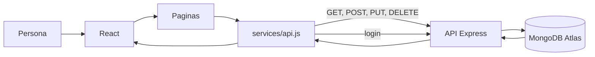

# Nana Nocturna — frontend

Este es el frontend de mi proyecto Nana Nocturna. Está hecho con React y Vite. El catálogo y las fichas muestran datos que obtiene de la API, y la aplicación permite iniciar sesión y gestionar piezas con una cuenta de administrador.

- Repositorio: [nana-nocturna-frontend](https://github.com/nadiamoukrimg/nana-nocturna-frontend)
- Repositorio del backend: [nana-nocturna-api](https://github.com/nadiamoukrimg/nana-nocturna-api)
- API utilizada: [https://nana-nocturna-api.vercel.app](https://nana-nocturna-api.vercel.app)

## Tecnologías

- React
- Vite
- React Router
- JavaScript y CSS
- API REST creada con Express
- MongoDB Atlas, a través del backend

## Organización

```text
frontend/
├── public/assets/img/       # Imágenes de las piezas
├── crear.html               # Entrada de la página de creación
├── src/
│   ├── components/          # Componentes reutilizables
│   ├── pages/               # Catálogo, ficha, login y creación
│   ├── services/api.js      # Peticiones a la API
│   ├── styles/              # Estilos
│   ├── create.jsx
│   └── main.jsx             # Rutas de la aplicación
├── .env.example
├── index.html
└── package.json
```

## Páginas

- `/`: catálogo de piezas.
- `/productos/:id`: ficha de una pieza.
- `/login`: inicio de sesión.
- `/crear` y `/crear.html`: formulario para crear piezas. Solo puede entrar una cuenta de administrador.

En la ficha, el administrador puede editar los datos, cambiar la disponibilidad o eliminar la pieza. Las cuentas de cliente pueden consultar el catálogo, pero no gestionar piezas.

## Conexión con la API

Las llamadas HTTP están centralizadas en `src/services/api.js`. El frontend utiliza estas rutas:

| Método | Ruta | Uso |
|---|---|---|
| GET | `/api/products` | Cargar el catálogo. |
| GET | `/api/products/:id` | Cargar una ficha. |
| POST | `/api/auth/login` | Iniciar sesión. |
| POST | `/api/products` | Crear una pieza. |
| PUT | `/api/products/:id` | Editar una pieza o cambiar su disponibilidad. |
| DELETE | `/api/products/:id` | Eliminar una pieza. |

Para crear, editar o eliminar, la aplicación envía el token de inicio de sesión. Los datos de las piezas se guardan en MongoDB a través del backend; no se simulan con una lista local.

## Instalar y ejecutar en local

Necesitas tener Node.js instalado. Abre una terminal en la carpeta `frontend` y ejecuta:

```powershell
npm.cmd install
Copy-Item .env.example .env.local
npm.cmd run dev
```

Vite indicará la dirección local de la aplicación, normalmente `http://localhost:5173`.

Para generar una versión de producción y verla localmente:

```powershell
npm.cmd run build
npm.cmd run preview
```

El frontend necesita que la API esté disponible. Para utilizar la API local, cambia temporalmente `VITE_API_URL` en `.env.local` a `http://localhost:3000/api` y arranca también el backend. Para usar la API desplegada, utiliza el valor de ejemplo.

## Variable de entorno

En `.env.local` se configura la dirección base de la API:

```env
VITE_API_URL=https://nana-nocturna-api.vercel.app/api
```

El archivo `.env.example` contiene el nombre y el valor de ejemplo para configurar el proyecto. En Vercel también hay que crear `VITE_API_URL` en las variables de entorno del frontend. Esta URL no es una contraseña. La URI de MongoDB y el secreto de los tokens pertenecen únicamente al backend.

## Imágenes

Las imágenes del proyecto están en `public/assets/img`. Para que se muestre una imagen nueva, su archivo debe estar en esa carpeta y el nombre o ruta guardado en la pieza debe coincidir con el archivo.

## Despliegue en Vercel

El frontend se despliega como un proyecto Vercel independiente conectado al repositorio `nana-nocturna-frontend`. Al importarlo, selecciona Vite y añade la variable `VITE_API_URL` con:

```text
https://nana-nocturna-api.vercel.app/api
```

Después de cambiar esa variable en Vercel hay que crear un nuevo despliegue. Cuando esté publicado, aquí se puede añadir la URL que asigne Vercel al frontend.

## Flujo de la aplicación

